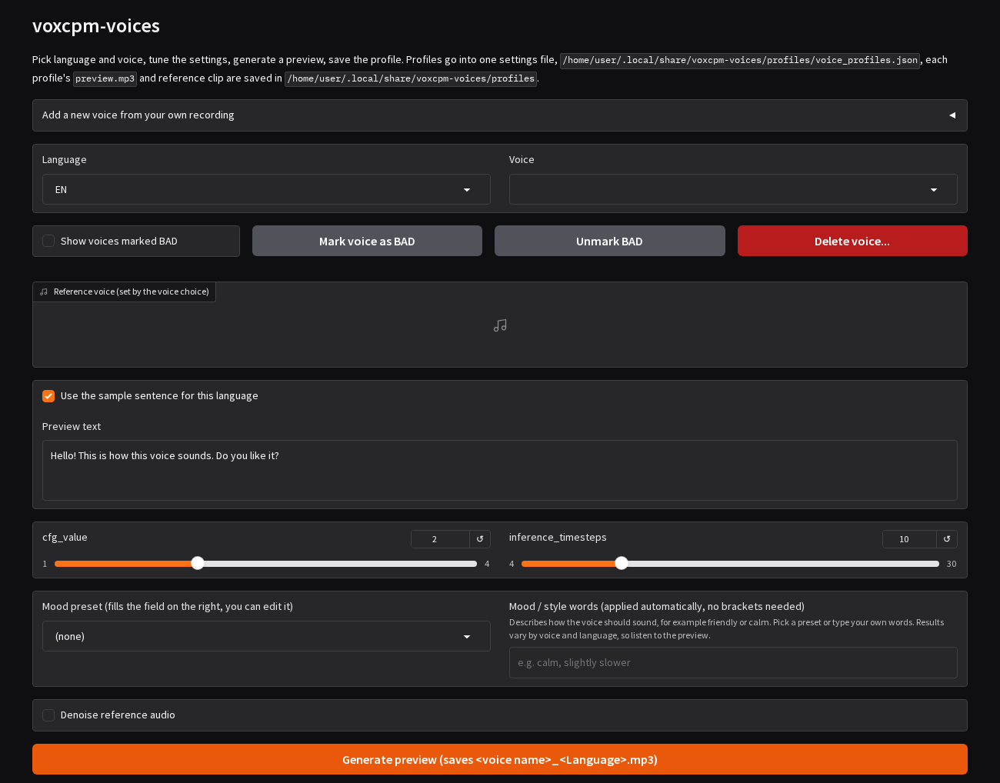

# voxcpm-voices

A small Gradio app to pick, tune and save voices for [VoxCPM2](https://huggingface.co/openbmb/VoxCPM2)
(text to speech with voice cloning), with a tiny API so other programs can speak with the voices you
saved.

I made this some months ago for my own use, and it has been doing its job ever since: simple,
tiny (one Python file), and it just works. So here it is, maybe it's useful to you too.



**Why not just plain VoxCPM?** VoxCPM2 clones a voice from a clip, but every call starts from
scratch. This app keeps what works: voices saved with their settings and mood per language, long
texts that stay in one voice and tone from start to finish, clean free voices to start with, and a
small API so other programs can just say "speak this with Anna". And you can make new voices from a
recording in a minute. Details below, under
[What makes it sound better](#what-makes-it-sound-better).

- Pick a language and a reference voice, tune `cfg_value`, steps, denoising and a mood ("calm,
  slightly slower"), listen to a preview, save it as a profile.
- Give voices a name, a gender and an avatar; mark bad ones so they disappear from the lists.
- **Create new voices**: record one right in the browser with your microphone, or upload a clip,
  and it becomes a voice like any other (see [Create your own voices](#create-your-own-voices)).
- Two API calls for other programs: `voices` lists the saved profiles, `speak` says a text with one.

It runs on the CPU (slowly: about twice as long as the audio it makes) or on a GPU.

## Install

Python 3.10 or newer, and `ffmpeg` for the mp3 previews.

```
git clone https://github.com/overcatbe/voxcpm-voices
cd voxcpm-voices
python3 -m venv env
env/bin/pip install torch torchaudio --index-url https://download.pytorch.org/whl/cpu   # or your GPU's build
env/bin/pip install -r requirements.txt
env/bin/python cpu_patch.py        # only for the CPU, see below
env/bin/python download_model.py   # about 4 GB, says a test sentence
```

**The CPU patch:** on the CPU, PyTorch's attention needs its mask with two dimensions, while VoxCPM
hands it one (fine on CUDA). `cpu_patch.py` adds one line to the installed `voxcpm` package that
means the same thing, and keeps the original as `model.py.orig`. Run it again after upgrading
voxcpm; it tells you if it is already patched.

## Run

```
HF_HUB_OFFLINE=1 env/bin/python voxcpm_voices.py      # http://127.0.0.1:7872
```

The model loads with the first preview. Everything you make (profiles, previews, avatars, your own
voices) lives in `~/.local/share/voxcpm-voices`; set `VOXCPM_VOICES_HOME` for another folder and
`VOXCPM_VOICES_PORT` for another port. The page only listens on 127.0.0.1.

## Voices to start with

The app has no voices of its own. Free ones, all **CC BY 4.0** (credit needed wherever you use them):

- **FLEURS** (Google): read sentences in about 100 languages,
  [huggingface.co/datasets/google/fleurs](https://huggingface.co/datasets/google/fleurs).
  `free_voices/download_fleurs.py` downloads German, Turkish, Russian, Arabic and Polish,
  `free_voices/screen_fleurs.py de:dev:female` picks clean 8 to 16 s clips.
- **CML-TTS**: LibriVox audiobooks in seven languages,
  [huggingface.co/datasets/ylacombe/cml-tts](https://huggingface.co/datasets/ylacombe/cml-tts).
  `free_voices/fetch_cml_api.py de pl` builds about 30 s references per speaker and downloads only
  the clips it uses.
- **VCTK**: English speakers with many accents. Put clips named `vctk_<speaker>.wav` into
  `~/.local/share/voxcpm-voices/vctk/` and they show up for every language.

The scripts put their picks into `free_voices/candidates/` in the data folder, with the attribution
file next to them. They are candidates: listen before you use one.

## Create your own voices

Open **Add a new voice from your own recording** at the top of the page:

1. **Record** with the microphone button, right in the browser, or **upload** a clip (any format
   ffmpeg reads; it is turned into mono WAV). 6 to 30 s of clean speech of one person works best;
   3 to 60 s are accepted. Read something calm and natural, in a quiet room.
2. Give it a **name** and the **language** it is spoken in, and optionally what is said in it.
3. Write down **where it comes from**: own voice, someone's written consent, or a license. This is
   required and saved next to the clip, so every voice can be traced later.
4. **Add voice**: it is selected below at once. Generate a preview, tune the settings and the mood,
   give it an avatar, and save the profile.

From then on it is a voice like the free ones: it speaks every language VoxCPM2 knows, not only the
one you recorded, and other programs can use it through the API. Your recordings stay on your
machine, in `profiles/custom_voices/` in the data folder.

**Your own voice, or anyone else's:** only clone voices you have the right to. Your own, or a
person's who agreed in writing, or a clip under a license that allows it. The app asks for that
note when you add a voice and keeps it next to the clip.

## What makes it sound better

A few things it does on top of plain VoxCPM2, learned the hard way:

- **Sentence by sentence, each one continuing the last.** Long texts are split into sentences; every
  sentence gets the previous one (its audio and text) as a prompt. The voice and the tone stay the
  same from the first sentence to the last instead of drifting, and there is a short pause (0.25 s)
  between sentences.
- **The mood goes on the first sentence only.** VoxCPM2 takes a mood as a few words in brackets in
  front of the text. It goes on the first sentence, and the chaining carries it through the rest. You pick a preset (calm, friendly, slow and clear, ...) or type your own words, the app
  adds the brackets.
- **Clean reference clips.** The free-voice scripts drop clips that are clipped (peak at the limit),
  noisy (a rough signal-to-noise check) or start with noise, and keep clean speech: 8 to 16 s for
  FLEURS, or 3 to 6 clips of one speaker joined with 0.3 s gaps to about 30 s for CML-TTS, so the
  model hears more of the voice.
- **Different voices, not the same one twice.** Picks of the same language and gender are chosen to
  differ in pitch, and each CML voice is a different speaker.
- **Any voice in any language.** VoxCPM2 clones across languages, so every voice is offered for every
  language (the ones recorded in it come first). Profiles are saved per language, so a voice can have
  its own settings and mood for each.
- **Bad voices out of the way.** Mark a voice as BAD and it disappears from the lists and the API.
- **Denoise** cleans a noisy reference before cloning; leave it off for clean clips.
- Memory is freed after every sentence, so long texts don't fill up the GPU.

## API

Besides the page, two calls (Gradio's plain HTTP API):

- `voices` (no inputs): the saved profiles, each `{"id", "name", "language", "gender", "style",
  "status", "bad"}`.
- `speak` (inputs: text, profile id): says the text with that profile's voice, settings and mood;
  the answer names a WAV file to fetch.

```
curl -s -X POST http://127.0.0.1:7872/gradio_api/call/speak -H 'Content-Type: application/json' \
     -d '{"data":["Hello there.","cml_de_7272__de"]}'          # -> {"event_id": "..."}
curl -sN http://127.0.0.1:7872/gradio_api/call/speak/<event_id>  # waits; the last line has the file's url
```

One model is loaded at a time; `speak` and the page's previews take turns.

## License

GPL-3.0-or-later, see `LICENSE`. Copyright (C) 2026 overcatbe.
VoxCPM2 is not part of this repository and has its own license; check it before commercial use.
The voices you download keep their own licenses (see above).
